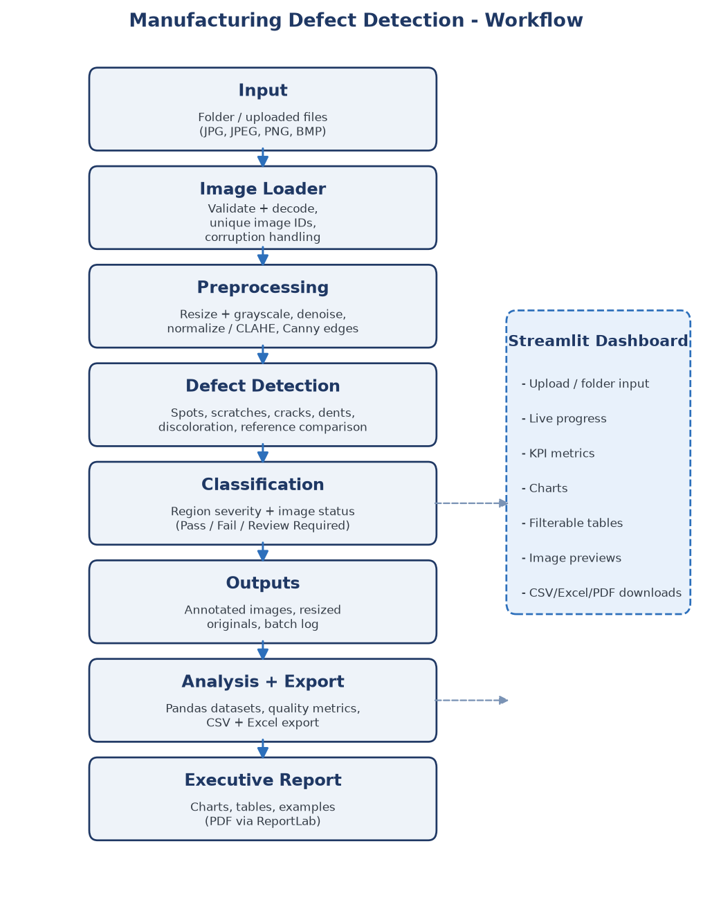
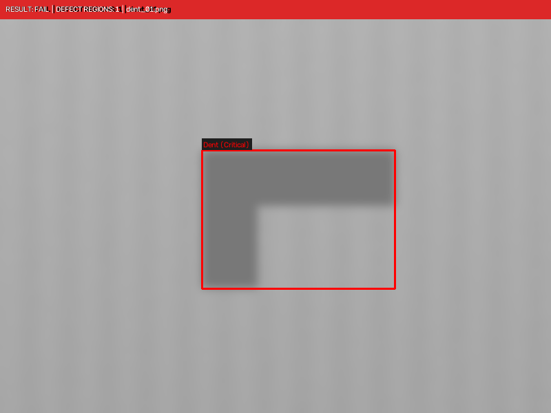

# Automated Manufacturing Defect Detection and Quality Audit System

A complete, production-style quality-audit pipeline for manufactured
parts: batch image processing with **OpenCV**, inspection logging and
statistics with **Pandas**, an interactive **Streamlit** dashboard, and
an automated executive **PDF report** - plus a ReportLab-generated
`README.pdf` built from this document.

> Detection is **rule-based heuristic computer vision**, not a trained
> machine-learning model. Every threshold lives in
> `config/settings.yaml`, every result in the report and dashboard comes
> from actual pipeline output, and the limitations are documented
> openly in section 15.

---

## 1. Overview

The system inspects folders of product photographs, detects and
classifies surface defects (spots, scratches, cracks, dents,
discoloration, and differences against an optional reference image),
assigns a severity to every defect region and a Pass / Fail /
Review Required status to every image, exports structured datasets,
and renders an executive quality report.

The full batch flow:

1. **Input** - a folder (or uploaded files) of JPG / JPEG / PNG / BMP
   images; corrupted or unsupported files are reported, never fatal.
2. **Image loader** - defensive decoding with unique image IDs
   (`IMG_0001`, ...).
3. **Preprocessing** - aspect-preserving downscale, grayscale, median
   denoise, optional normalisation / CLAHE, and Canny edge maps.
4. **Defect detection** - six independent rule-based detectors.
5. **Classification** - per-region severity (Minor / Major / Critical)
   and per-image status (Pass / Fail / Review Required).
6. **Outputs** - annotated images, resized originals, a batch log, three
   Pandas datasets plus distribution tables, CSV + Excel export.
7. **Reporting** - an executive PDF with KPIs, charts, the inspection
   table, failed / review cases, image examples, observations, follow-up
   actions and method limitations.

## 2. Key Features

- **Batch processing** of folders or in-memory uploads with live
  progress, per-image timing, and unique batch IDs
  (`BATCH_YYYYMMDD_HHMMSS`) so repeated runs never overwrite outputs.
- **Six explainable detectors** - background-difference spots, Canny
  scratches, low-solidity cracks, broad dents, HSV discoloration and an
  optional reference-image comparison.
- **Two-level defect counting** - *region level* (each detected region
  is one defect record with bbox, area, severity) and *image level*
  (an image is defective when it contains at least one region), so the
  statistics never double-count.
- **Configurable everything** - all thresholds live in
  `config/settings.yaml` and can be overridden live in the dashboard.
- **Three core datasets** (inspection log, defect details, quality
  summary) plus category / severity / batch-statistics tables, exported
  to CSV and a multi-sheet Excel workbook.
- **Executive PDF report** generated automatically for every batch,
  with charts and embedded original-vs-annotated image examples.
- **Graceful failure handling** - unreadable images become `Error` rows
  and are listed in the dashboard and report; empty batches refuse to
  produce a report instead of fabricating one.
- **Tested** - 35 pytest unit/integration tests covering the core
  calculations and the full pipeline (see section 13).

## 3. System Architecture



The pipeline is strictly sequential per image; the Streamlit dashboard
wraps the same `run_batch()` entry point used by the command line, so
UI and CLI always produce identical artefacts.



An annotated result: the status banner, per-region bounding boxes
coloured by severity (yellow = Minor, orange = Major, red = Critical)
and the region labels.

## 4. Folder Structure

```text
Automated Detections/
|-- app.py                        # Streamlit dashboard (UI entry point)
|-- conftest.py                   # pytest path bootstrap
|-- requirements.txt              # pinned dependencies
|-- README.md                     # this document
|-- README.pdf                    # generated from README.md (ReportLab)
|-- config/
|   `-- settings.yaml             # every tunable threshold
|-- data/
|   `-- sample_images/            # 8 generated demo images (incl. 1 corrupt)
|-- docs/
|   `-- assets/
|       |-- workflow_diagram.png  # architecture diagram (generated)
|       `-- annotated_example.png # sample annotated output
|-- scripts/
|   |-- generate_sample_images.py # creates the demo dataset
|   |-- generate_workflow_diagram.py
|   |-- run_batch.py              # command-line batch runner
|   `-- generate_readme_pdf.py    # rebuilds README.pdf
|-- src/
|   |-- __init__.py
|   |-- image_loader.py           # defensive loading + validation
|   |-- preprocessing.py          # resize / gray / denoise / edges
|   |-- defect_detector.py        # six rule-based detectors
|   |-- defect_classifier.py      # severity + status rules (+ ML hook)
|   |-- quality_metrics.py        # Pandas aggregations
|   |-- data_logger.py            # CSV / Excel persistence
|   |-- report_generator.py       # executive PDF report
|   |-- pipeline.py               # end-to-end orchestration
|   |-- readme_pdf.py             # Markdown -> PDF converter
|   `-- utils.py                  # config, logging, annotation drawing
|-- tests/                        # 35 pytest tests
`-- outputs/
    `-- <BATCH_ID>/               # one unique folder per run
        |-- annotated_images/     # IMG_XXXX_annotated.png
        |-- originals/            # IMG_XXXX_original.png (processed size)
        |-- csv/                  # six CSV datasets
        |-- excel/                # inspection_data.xlsx
        |-- reports/              # quality_report_<BATCH_ID>.pdf + charts
        `-- logs/                 # batch log file
```

## 5. Technology Stack

| Component | Library | Used for |
| --- | --- | --- |
| Image processing | OpenCV (`opencv-python`) | decoding, filtering, Canny, contours, HSV, annotation |
| Numerics | NumPy | arrays, statistics, masking |
| Data handling | Pandas | the three datasets and all aggregations |
| Excel export | OpenPyXL (via Pandas) | multi-sheet `inspection_data.xlsx` |
| Dashboard | Streamlit | upload, progress, metrics, charts, tables, downloads |
| Charts | Matplotlib | report/dashboard charts and the workflow diagram |
| PDF reports | ReportLab | executive report and this README.pdf |
| Images in PDFs | Pillow | size probing for embedded images |
| Configuration | PyYAML | `config/settings.yaml` |
| Testing | Pytest | 35 unit / integration tests |

Exact versions used for the verified run are listed in section 14.

## 6. Installation

Requires Python 3.11+ (verified on Python 3.13.5, Windows).

```bash
# 1 - create and activate a virtual environment
python -m venv .venv
.venv\Scripts\activate          # Windows (cmd: .venv\Scripts\activate.bat)

# 2 - install the dependencies
python -m pip install --upgrade pip
python -m pip install -r requirements.txt

# 3 - (optional) regenerate the demo data and diagrams
python scripts\generate_sample_images.py
python scripts\generate_workflow_diagram.py
```

There are no compiled project artefacts, no model downloads and no
API keys - after `pip install` the system is fully functional offline.

## 7. Running the Application

### 7.1 Streamlit dashboard (recommended)

```bash
.venv\Scripts\python.exe -m streamlit run app.py
```

The browser opens automatically (default `http://localhost:8501`).

**Dashboard workflow:**

1. **Image source** - choose *Folder on this computer* (default:
   `data/sample_images`) or *Upload image files* (multi-select).
2. Optionally enter a **reference image path** to enable the
   reference-comparison detector.
3. Expand **Detector toggles** to switch individual detectors on/off,
   and **Severity and status thresholds** to tune Pass / Fail /
   Review behaviour live.
4. Press **Run inspection** - a progress bar tracks each image.
5. Review the results: KPI metrics, four charts, the filterable
   inspection log, per-image original-vs-annotated preview, and
   download buttons for the CSVs, the Excel workbook, the PDF report
   and a ZIP of all annotated images.

### 7.2 Command line

```bash
.venv\Scripts\python.exe scripts\run_batch.py --input data\sample_images
```

| Option | Meaning |
| --- | --- |
| `--input PATH` | folder with the images (default: `data/sample_images`) |
| `--reference PATH` | optional reference image |
| `--settings PATH` | alternative settings YAML |
| `--output-root PATH` | alternative output root |
| `--no-report` | skip the executive PDF |

The CLI prints the full KPI summary, every output file path and the
batch folder. UI and CLI share `src.pipeline.run_batch()`, so results
are identical for the same inputs and settings.

## 8. Detection Methodology

All six detectors are **deterministic rule-based heuristics** operating
on the preprocessed image. There is no learning component in the
default pipeline; every number below is a configured threshold.

### 8.1 Preprocessing

For an input image `I` (BGR):

- Downscale so `width <= max_display_width` (aspect preserved,
  never upscaled); the scale factor `s` is recorded.
- Grayscale: `G = 0.114 B + 0.587 G + 0.299 R` (OpenCV BT.601).
- Denoise: `D = medianBlur(G, k)` with `k = 5` (or Gaussian).
- Edges: `E = Canny(GaussianBlur(G, 3x3), t_low, t_high)` - the light
  blur keeps 1-3 px lines visible; the stronger median denoise would
  erase them.

### 8.2 Spot detector (spots / stains)

1. Local background: `B = medianBlur(D, 31)`.
2. Deviation: `diff = |D - B|`.
3. Mask: `diff > max(Otsu(diff), min_contrast)`; open 3x3, close 5x5.
4. Keep contours with
   `min_area <= area <= max_area`,
   `circularity = 4*pi*A / P^2 >= min_circularity`,
   `solidity = A / A_hull >= min_solidity`.
5. Intensity score: `score = mean(diff in region) / (4 * min_contrast)`,
   clipped to `[0.05, 1]`.

A statistical flatness gate (`std(|D - median(D)|) < 2`) skips the
blob detectors on uniform images so pure noise cannot create phantom
regions.

### 8.3 Scratch detector (thin elongated marks)

1. Canny edges from the scratch thresholds.
2. Anisotropic closing: horizontal `1x15` and vertical `15x1` kernels
   join collinear edge fragments.
3. For every contour, the minimum-area rectangle gives
   `length` and `thickness`; accept when
   `length >= 40`, `thickness <= 9` and
   `aspect = length / thickness >= 5`.

### 8.4 Crack detector (jagged edge structures)

1. Canny edges (crack thresholds), dilated by 3 px, closed 5x5.
2. Accept contours with
   `solidity <= 0.65` (jagged shapes fill their convex hull poorly),
   `aspect >= 3` and `area >= 60`.

### 8.5 Dent detector (broad irregular deviations)

1. Global surface level: `mu = median(D)`;
   `diff = |D - mu|` - broad defects are *wider than any local median
   window*, so a global comparison is required (a local median would
   self-cancel them).
2. Mask: `diff > max(Otsu(diff), min_contrast)`; open 3x3, close 7x7.
3. Accept contours with
   `area >= 0.4%` of the image, `circularity <= 0.65` and
   `solidity <= 0.92` (irregular, non-round shapes).

### 8.6 Discoloration detector (colour deviation)

In HSV space, with `S_med` and `H_med` the image medians and
`hue_dist = min(|H - H_med|, 180 - |H - H_med|)` (circular distance):

- mask = `(S > 45) & (|S - S_med| > 30)` OR
  `(S > 45) & (hue_dist > 18)`;
- keep regions with `area >= 150`; score uses the mean saturation
  deviation.

### 8.7 Reference detector (optional)

With a reference image resized to the working size:
`diff = |GaussianBlur(D) - GaussianBlur(Ref)|`, masked at
`max(Otsu(diff), 25)`, regions `area >= 60`.

### 8.8 Severity and status rules

Per region, with `r = area / image_area`:

| Condition | Severity |
| --- | --- |
| `r >= 0.05` | Critical |
| `r >= 0.01` | Major |
| otherwise | Minor |

Category floors can raise severity (cracks are at least Major).
The image status is then decided in this order (first match wins):

1. any Critical region -> **Fail**
2. cumulative area ratio `>= 0.08` -> **Fail**
3. region count `>= 8` -> **Fail**
4. any Major region -> **Review Required**
5. cumulative area ratio `>= 0.015` -> **Review Required**
6. region count `>= 3` -> **Review Required**
7. otherwise -> **Pass** (zero regions is a clean pass)

### 8.9 Optional ML hook

`src/defect_classifier.py` ships `ExternalModelClassifier`, a working
`cv2.dnn` wrapper: set `ml.enabled: true`, provide an ONNX file and a
class list, and every detected region crop is classified by the model
with a softmax probability attached to the record. No model is
distributed with this project, the hook is disabled by default, and it
must not be confused with the rule-based pipeline.

## 9. Data Schemas

**inspection_log.csv** - one row per processed image:

| Column | Type | Meaning |
| --- | --- | --- |
| `image_id` | str | unique ID (`IMG_0001`) |
| `filename` | str | original file name |
| `batch_id` | str | batch identifier |
| `width`, `height` | int | processed image size (px) |
| `num_defects` | int | defect regions in this image (image level) |
| `total_defect_area_px` | int | sum of region areas (px) |
| `defect_area_ratio` | float | defect area / image area |
| `categories_detected` | str | comma-separated category list |
| `max_severity` | str | None / Minor / Major / Critical |
| `status` | str | Pass / Fail / Review Required / Error |
| `status_reason` | str | rule that decided the status |
| `processing_time_ms` | float | wall time for this image |
| `error_message` | str | load or processing error, if any |

**defect_details.csv** - one row per defect region (region level):

| Column | Type | Meaning |
| --- | --- | --- |
| `defect_id` | str | `IMG_0004_D01` (image + region index) |
| `image_id` / `filename` / `batch_id` | str | parent image |
| `category` | str | Spot / Scratch / Crack / Dent / Discoloration / Reference Difference |
| `method` | str | detector description |
| `bbox_x` / `bbox_y` / `bbox_w` / `bbox_h` | int | bounding box (px, processed coordinates) |
| `area_px` | int | region area (px) |
| `area_ratio` | float | region area / image area |
| `severity` | str | Minor / Major / Critical |
| `score` | float | heuristic strength in [0.05, 1] |

**quality_summary.csv** - one KPI row per batch: batch id, generation
time, images found / processed / failed-load / inspected, defective
images, total defect regions, passed / failed / review counts,
processing errors, defect rate (%), pass rate (%), average regions per
image, most frequent defect type and its count.

Additional tables: `category_distribution.csv`
(category, region_count, image_count, share_pct),
`severity_distribution.csv` (severity, region_count, share_pct) and
`batch_statistics.csv` (one KPI row per batch id). The Excel workbook
`inspection_data.xlsx` contains all six tables as sheets.

**Counting definitions.** An *inspection record* is one successfully
processed image; a *defect region* is one detected region inside one
image; an image is *defective* when it contains at least one region;
`defect rate = defective images / inspected images * 100` (image
level) and the region totals in the defect log are additive at region
level - the two levels are never mixed in one metric.

## 10. Module Implementation Details

| Module | Responsibility | Key implementation points |
| --- | --- | --- |
| `src/image_loader.py` | Defensive loading | `cv2.imdecode` on raw bytes; empty/corrupt/unsupported files become failed records, never exceptions; unique `IMG_NNNN` IDs for folders and uploads |
| `src/preprocessing.py` | Preparation | aspect-preserving downscale, grayscale, median/Gaussian denoise, optional percentile normalisation and CLAHE, Canny edge map from lightly blurred gray |
| `src/defect_detector.py` | Detection | six independent detectors; shared contour pipeline (`circularity`, `solidity`, min-area rectangle); IoU dedupe; per-category priority; region cap |
| `src/defect_classifier.py` | Decisions | area-ratio severity with category floors; ordered status rules; rule descriptions for the report; optional ONNX hook |
| `src/quality_metrics.py` | Analytics | KPI aggregation (error rows excluded from rates), category / severity / batch aggregations with pandas `groupby` |
| `src/data_logger.py` | Persistence | six CSV files + six-sheet Excel workbook, fixed column schemas |
| `src/report_generator.py` | PDF report | ReportLab story: cover, KPI table, category/severity tables, four Matplotlib charts, inspection table, failed/review list, image examples, data-driven observations, actions, method + limitations |
| `src/pipeline.py` | Orchestration | unique batch dirs, per-image try/except (errors become rows), annotated image rendering, dataset assembly, exports, report |
| `src/readme_pdf.py` | Docs | Markdown subset parser (headings, lists, tables, code, images, quotes), Python/bash/yaml syntax highlighting, cover + clickable TOC + footer |
| `src/utils.py` | Shared | YAML config loading with deep-merge defaults, batch IDs / unique dirs, logger setup, status/severity constants, annotation drawing |
| `app.py` | Dashboard | sidebar input + threshold controls, progress callback into `run_batch`, session-state results, metrics / charts / filterable tables / previews / downloads |

**Annotation rendering** (`src/utils.annotate_image`) draws a coloured
status banner (`RESULT: ... | DEFECT REGIONS: n`), one rectangle per
region coloured by severity, and a `category (severity)` label per
box, scaling line widths with image size.

## 11. Outputs

Every run writes to `outputs/<BATCH_ID>/` (unique; colliding IDs get a
`_1`, `_2`, ... suffix):

| File | Content |
| --- | --- |
| `annotated_images/IMG_XXXX_annotated.png` | status banner + severity-coloured boxes |
| `originals/IMG_XXXX_original.png` | the processed (resized) input |
| `csv/inspection_log.csv` | one row per image |
| `csv/defect_details.csv` | one row per defect region |
| `csv/quality_summary.csv` | batch KPIs |
| `csv/category_distribution.csv` | category counts and shares |
| `csv/severity_distribution.csv` | severity counts and shares |
| `csv/batch_statistics.csv` | per-batch statistics |
| `excel/inspection_data.xlsx` | all six tables as sheets |
| `reports/quality_report_<BATCH_ID>.pdf` | executive report |
| `reports/*.png` | the charts embedded in the report |
| `logs/<BATCH_ID>.log` | timestamped processing log |

The executive report contains: title block with batch ID and overall
status, the KPI summary with metric definitions, category and severity
tables, distribution charts, the inspection results table (first 25
rows, full data in the CSVs), failed and review-required cases with
their rule reasons, original-vs-annotated image pairs (failures first),
data-derived key observations, suggested follow-up actions, and the
active detection/severity rules with an honest limitations section.
Report generation is **refused** when a batch contains no valid
inspection records.

## 12. Configuration Reference

All thresholds live in `config/settings.yaml` (loaded with deep-merged
built-in defaults, so partial files are valid):

| Key | Default | Effect |
| --- | --- | --- |
| `processing.max_display_width` | 800 | working width; larger images are scaled |
| `processing.denoise_method` / `denoise_ksize` | median / 5 | denoising of the analysis image |
| `processing.normalize` / `use_clahe` | false / false | optional contrast enhancement |
| `detection.spot.*` | see YAML | background kernel 31, contrast floor 18, area 20-3000, circularity >= 0.25, solidity >= 0.5 |
| `detection.scratch.*` | see YAML | Canny 45/140, connect 15, aspect >= 5, thickness <= 9, length >= 40 |
| `detection.crack.*` | see YAML | Canny 40/130, dilate 3, aspect >= 3, solidity <= 0.65 |
| `detection.dent.*` | see YAML | contrast floor 12, area >= 0.4%, circularity <= 0.65, solidity <= 0.92 |
| `detection.discoloration.*` | see YAML | sat offset 30, hue offset 18, min saturation 45, area >= 150 |
| `detection.reference.*` | see YAML | contrast floor 25, area >= 60 |
| `detection.max_regions_per_image` / `dedupe_iou` | 200 / 0.6 | region cap and overlap merge |
| `severity.major_area_ratio` / `critical_area_ratio` | 0.01 / 0.05 | region severity boundaries |
| `severity.category_floor` | Crack: Major | minimum severity per category |
| `severity.fail_*` / `review_*` | see YAML | image status thresholds |
| `ml.*` | disabled | optional ONNX hook |
| `report.max_table_rows` / `max_image_examples` | 25 / 4 | PDF layout limits |
| `output.root` | outputs | output root folder |

## 13. Testing

The pytest suite lives in `tests/` and runs in about three seconds:

```bash
.venv\Scripts\python.exe -m pytest tests -v
```

| Test file | Coverage |
| --- | --- |
| `test_preprocessing.py` | grayscale, aspect-preserving resize, denoising, contrast stretch, edge threshold ordering, empty-image rejection |
| `test_image_loader.py` | supported extensions, folder scans, corrupt-file handling, missing folders, upload validation |
| `test_defect_detection.py` | clean surface (no false positives), spot / scratch / crack / dent / reference detection, detector toggles, severity and status rules |
| `test_quality_metrics.py` | KPI aggregation, error-row exclusion, category / severity / batch statistics |
| `test_data_logger.py` | CSV round-trip with schema check, Excel sheet structure |
| `test_report_generation.py` | full batch produces every artefact, empty/corrupt-only folders raise, report refuses empty records |
| `test_readme_pdf.py` | Markdown -> PDF conversion of every supported block type |

**Actual result of the final verification run (this project):**

```text
tests/test_preprocessing.py ..............  7 passed
tests/test_image_loader.py ...............  5 passed
tests/test_defect_detection.py ...........  9 passed
tests/test_quality_metrics.py ............  6 passed
tests/test_data_logger.py ................  2 passed
tests/test_report_generation.py ..........  4 passed
tests/test_readme_pdf.py .................  2 passed

35 passed in 2.62s
```

Only the tests listed above were executed; no other results are
claimed. One earlier test expectation (edge threshold ordering) was
corrected during development because the original assumption about
Canny behaviour was wrong - the corrected test asserts that swapped
thresholds are handled without errors and still detect the step edge.

## 14. Verified Example Batch

The following numbers come from the actual reference run of this
project on `data/sample_images` (8 generated images including one
deliberately corrupted file) with default `settings.yaml`:

```text
batch_id                  : BATCH_20261010_154653
images_found              : 8      images_processed : 8
images_failed_load        : 1      images_inspected : 7
defective_images          : 6      total_defect_regions : 15
passed                    : 1      failed    : 1   review_required : 5
defect_rate_pct           : 85.71  pass_rate_pct : 14.29
avg_defects_per_image     : 2.14   most_frequent : Spot (8 regions)
```

Per-image results (from `inspection_log.csv`):

| Image | Regions | Category (severity) | Status | Time |
| --- | --- | --- | --- | --- |
| `clean_01.png` | 0 | - | Pass | 43.7 ms |
| `corrupted_sample.jpg` | - | unreadable | Error | - |
| `crack_01.png` | 1 | Crack (Major) | Review Required | 33.1 ms |
| `dent_01.png` | 1 | Dent, 31634 px (Critical) | **Fail** | 35.6 ms |
| `discoloration_01.png` | 1 | Discoloration (Major) | Review Required | 41.3 ms |
| `mixed_02.png` | 6 | 5 Spot (Minor) + 1 Crack (Major) | Review Required | 41.0 ms |
| `scratch_01.png` | 3 | 3 Scratch (Minor) | Review Required | 39.6 ms |
| `spot_01.png` | 3 | 3 Spot (Minor) | Review Required | 36.3 ms |

Category distribution: Spot 8 (53.33 %), Scratch 3 (20.00 %),
Crack 2 (13.33 %), Discoloration 1 (6.67 %), Dent 1 (6.67 %).
Severity distribution: Minor 11 (73.33 %), Major 3 (20.00 %),
Critical 1 (6.67 %).

Artefacts produced by this run: 7 annotated images, 7 resized
originals, 6 CSV files, the six-sheet Excel workbook, the batch log,
4 chart images and the executive PDF report
(`quality_report_BATCH_20261010_154653.pdf`, 2.36 MB, 6 pages).

Environment of the verified run: Windows 11, Python 3.13.5,
opencv-python 5.0.0.93, numpy 2.5.3, pandas 3.0.6, matplotlib 3.11.2,
streamlit 1.65.0, reportlab 5.0.1, openpyxl 3.1.5, PyYAML 6.0.3,
pytest 9.1.1, Pillow 12.3.0.

## 15. Limitations and Method Disclosures

- **Heuristic, not trained.** Detection is classical computer vision
  with hand-tuned thresholds. No ground-truth labels exist for the
  sample data, so no accuracy / precision / recall numbers are claimed
  anywhere in this project.
- **Category confusion is possible.** The categories are geometric
  interpretations: in the verified batch the straight scratch drawn on
  `mixed_02.png` was classified as a *Crack* (its closed edge contour
  was sufficiently non-convex after denoising). Treat categories as
  hints for human review, not ground truth.
- **Lighting sensitivity.** Global-contrast detectors assume a roughly
  uniform surface; strong vignetting, shadows or textured backgrounds
  can create false regions. Capture images on a plain, evenly lit
  background for best results.
- **Thin-line erosion.** The median denoise (k=5) erases lines thinner
  than ~3 px; edge detectors therefore work on a lightly blurred
  grayscale image instead, which trades some noise robustness for thin
  scratch visibility.
- **Self-cancellation of broad defects.** A local median background
  cannot see defects wider than half its kernel; the dent detector
  compares against the global surface level for this reason, which in
  turn makes it sensitive to global illumination shifts.
- **Severity is area-based.** A tiny but process-critical defect
  (e.g. a hairline crack) is only elevated by the category floor, not
  by any semantic understanding.
- **Coordinates are processed-image coordinates.** Bounding boxes refer
  to the resized working image (width <= 800), not the original file.
- **The ML hook is not a feature claim.** `ExternalModelClassifier` is
  a working integration point, but no model ships with the project and
  its behaviour is unverified without one.

## 16. Troubleshooting

| Symptom | Cause | Fix |
| --- | --- | --- |
| `No supported image files ... were found` | wrong folder or non-image files only | point `--input` / the sidebar at a folder with JPG/JPEG/PNG/BMP files |
| `None of the N image file(s) could be processed` | all files are corrupt | check the source images; corrupt files are listed in the dashboard and the log |
| Too many false regions on textured parts | contrast floors too low for the surface | raise `min_contrast` / `min_area` in `config/settings.yaml` |
| Real defects missed | thresholds too strict, or defects below the contrast/area floors | lower `min_contrast`, `min_area`, or the severity boundaries; verify on the annotated output |
| Everything is Review Required | review thresholds too tight for the batch | raise `review_defect_count` / `review_total_area_ratio` |
| Report missing for a run | batch had zero valid inspection records | the system refuses to fabricate a report; fix the inputs and rerun |
| `streamlit: command not found` | global PATH has no Streamlit | run `.venv\Scripts\python.exe -m streamlit run app.py` |
| Garbled box-drawing characters in README.pdf | DejaVu fonts unavailable | they ship with Matplotlib; reinstall `matplotlib` (the converter then falls back to core fonts) |

---

Built as a complete, self-contained quality-audit toolkit: OpenCV
detection, Pandas analytics, Streamlit interaction, ReportLab
reporting - with every threshold configurable, every output traceable
to a batch folder, and every documented number taken from an actual
run of the code in this repository.
